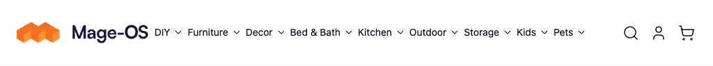

# Category imports and navigation

The current source module preserves commas in WANDS category names and curates
nine departments after each successful `lab:wands:import`. Validation-only and
failed imports do not curate navigation. The published October 6 archives contain
the older module and retain their documented manual curation step.

The menu order is DIY, Furniture, Decor, Bed & Bath, Kitchen, Outdoor, Storage,
Kids and Pets. Lighting and Rugs are the first two children of Decor.
Other root children, including Room Bundles and QA Fixtures, remain active and are
hidden from the menu.

## Existing trees and repeated imports

Curation normalizes legacy department labels and moves the existing Lighting and
Rugs categories, including their descendants, under Decor. It preserves category
IDs and direct product assignments. DIY uses the `diy` URL key. Changing an older
tree regenerates its category and
product URLs through Magento without redirect history, and updates persisted
descendant URL paths. Department positions are saved in the approved order.
Fresh release CSVs contain canonical category paths, including `WANDS Catalog/DIY`.
Generated DIY product SKUs, URL keys, variant references and JSON inventories use
the same canonical identifiers. An older release with different product SKUs
requires an approved migration or reset; append updates refuse SKU removals.

The category processor normalizes exported legacy paths to the curated hierarchy.
While an older tree awaits curation, aliases resolve those normalized paths to the
existing IDs. Repeated imports therefore reuse the same branches. Conflicting old
and canonical branches are rejected before category creation.
Each importer adapter receives a fresh category processor. This keeps cached parent
paths current when several imports run in the same process.

Successful import output includes a `navigation` object with visible, hidden,
renamed, moved, reordered and changed-URL department counts. Unchanged values are not saved again.
Changes clear the block and full-page caches. Curation uses default-scope names and
visibility; pre-existing store-view overrides need their own review.

The standalone command supports a dry run:

```sh
php bin/magento lab:wands:curate-navigation --dry-run
php bin/magento lab:wands:curate-navigation
```

Back up the affected category records and store URL rewrites before migrating an
existing catalog. Refresh the affected category and search indexes afterward.

## Category path format

Each assignment starts with `WANDS Catalog/`. Commas inside a path are name data,
such as `WANDS Catalog/Kitchen/Vases, Urns, Jars & Bottles`. Multiple
assignments repeat the root:

```text
WANDS Catalog/Slicers, Peelers And Graters,WANDS Catalog/Kitchen/Tools
```

The plugin uses a separate internal path delimiter for comma-separated WANDS
assignments. Explicit alternative delimiters also receive path normalization.
Other catalogs retain native parsing. The global comma separator remains in place
for product links, configurable data and other fields.

Previously created comma fragments are retained. This update prevents new splits
and migrates the nine departments; it does not repair unrelated fragment
assignments. That repair requires its own reviewed migration.

QA Fixtures remains reachable through its direct category URL, normally
`qa-fixtures.html`. The browser verifier accepts `--qa-category-path`.

## Test-store verification, October 14, 2026

Both `latest.rocketcode.com` and `latest-hyva.rocketcode.com` contain exactly 107,815
WANDS products. Their dedicated test-store cleanup removed the other products and
empty sample category trees. A bounded native rebuild replaced 2000 generated
product identifiers with their canonical DIY counterparts. The other 105,815
product identities, data, stock and media were preserved.

The WANDS module provides the navigation stylesheet. Hyvä uses 14 px labels and
closer spacing through the 1535 px container breakpoint. At narrower desktop
widths, compact spacing and icons apply to fine pointers. The layout handle is
scoped to the WANDS website; the compact wrapper rule applies to Hyvä.

| Theme | Tested desktop widths in pixels | Menu rows | Visible departments | Horizontal overflow |
| --- | --- | ---: | ---: | --- |
| Luma | 1024, 1100, 1279, 1280, 1440, 1614, 1920 | 1 | 9 | None |
| Hyvä Default 1.5.3 | 1024, 1100, 1279, 1280, 1440, 1614, 1920 | 1 | 9 | None |

Measurements waited for Luma's menu widget to initialize. DIY category grids and
a rebuilt configurable product opened on both themes; Black and Small variant
options were selectable. Removed category and generated product URLs returned
404 without redirects. Native indexes were rebuilt and versioned static assets
were verified in production mode.




Module PHPUnit passed 32 tests with 148 assertions, with coverage of the curator,
taxonomy normalizer, category aliases, comma plugin and importer. The descendant
URL regression failed with its fix disabled, then passed with it restored. The
isolated staged checkout passed 912 tooling tests with one optional disposable-store check skipped.
Each full test store passed 834,131 catalog/media checks and 963,240 stock checks.
See [the cleanup acceptance report](DIY_CATALOG_ACCEPTANCE_2026-10-14.md).

The native lifecycle check exercises parent paths between import adapters and
rolls back the fixture transaction. Run it only against a disposable navigation fixture:

```sh
php dev/tools/wands_catalog/tests/acceptance/navigation_import_lifecycle.php [FIXTURE ROOT]
```

This acceptance covers desktop navigation and catalog pages. The corrected catalog
candidate is private; published release archives retain their existing identities.
